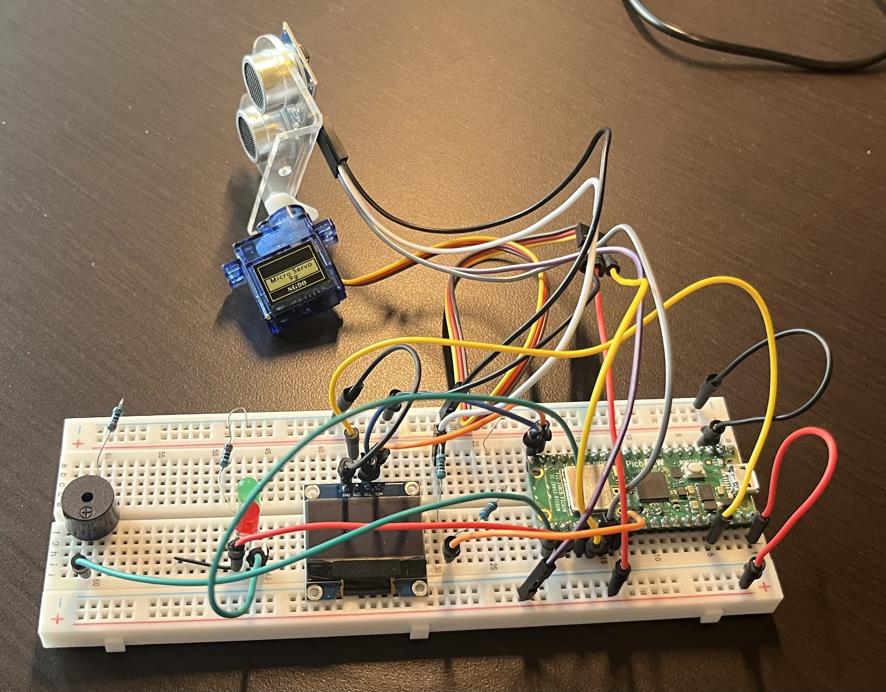

# Radar Scanner

## Overview
This project uses a Raspberry Pi Pico 2 W to create a radar scanner using a Ultrasoinc Sensor, Servo Motor, OLED Display, LEDs, and a Buzzer. An Ultrasonic Sensor reads the time it takes for a sound wave to return and sends it back to the microcontroller as it sweeps in a 180 degree rotation loop. An SSD1306 Display shows the distsance and a buzzer and LED system display whether or not an object is too close in real time.

## Hardware
- Raspberry Pi Pico 2 W
- HC-SR04 Ultrasonic Sensor
- Micro Servo
- SSD1306 128x64 I2C OLED Display
- 3 1kohm Resistors
- Buzzer
- LEDs
- Breadboard
- Jumper Wires

## Wiring

**Ultrasonic Sensor**
- VCC - VBUS
- GND - GND
- Trig - GP20
- Echo - GP21

**OLED**
- VCC - 3.3V
- GND - GND
- SDA - GP14
- SCL - GP15

**Buzzer**
- Input - GP16

**LEDs**
- Green LED - GP18
- Red LED - GP17

**Servo**
- VCC - VBUS
- GND - GND
- Input - GP19

## Features
- Reads input from Ultrasonic Sensor
- Sweeps Servo in 180 degree loop
- Converts readings into distance in cm
- Displays live data on a 128x64 OLED display
- Shows distance warning if under 20cm
- Demonstrates I2C and GPIO communication

## Results
The Ultrasonic Sensor succesfully tracked and outputted the correct distance and displayed that distance on the OLED display through the sweeping motion. The LEDs and buzzer also succesfully showed the user when an object was too close

## Future Improvements
-- Create a UI map of distance
-- Use a full 360 degree radar using a different motor
